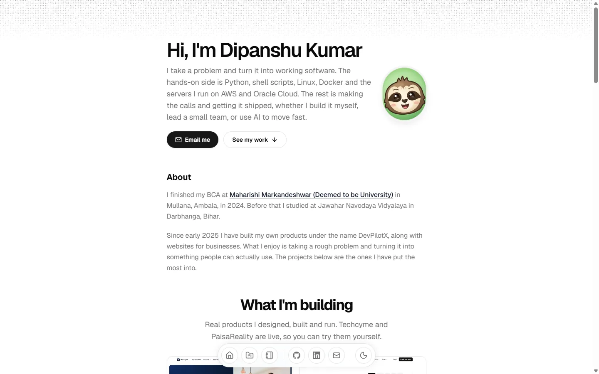
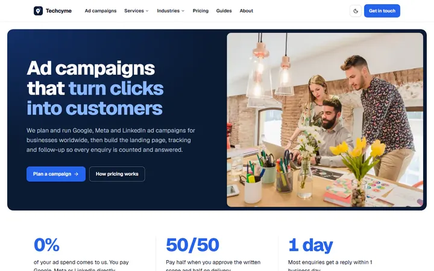
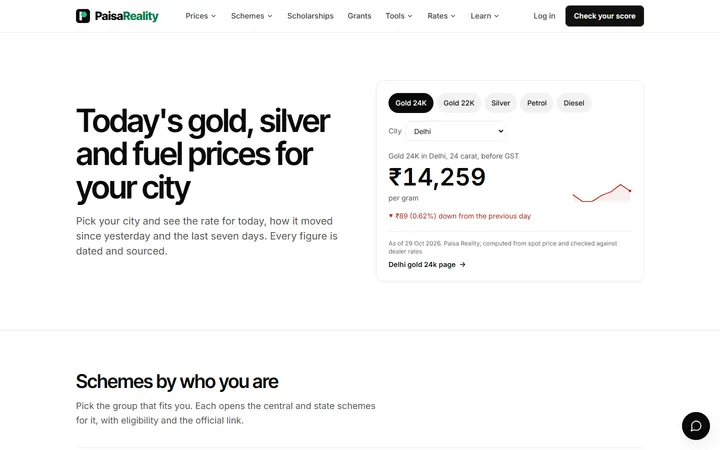
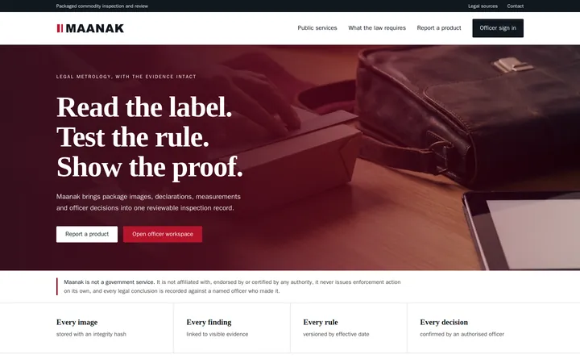
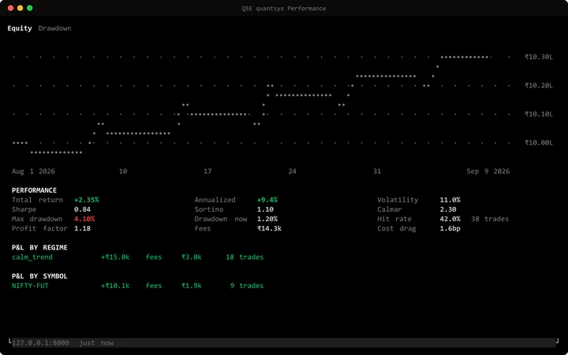
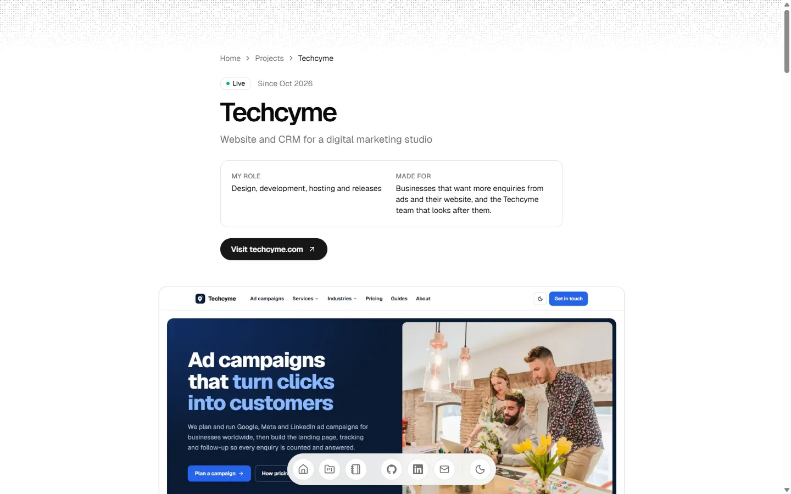
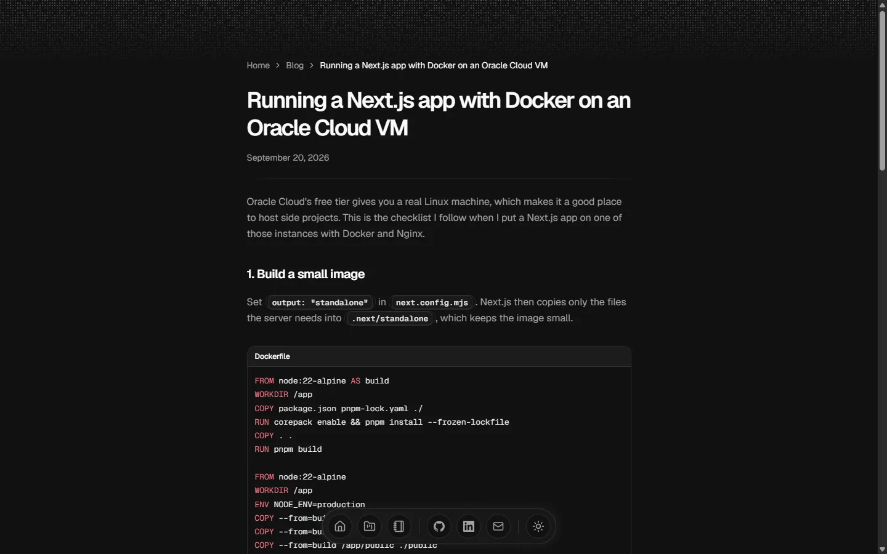
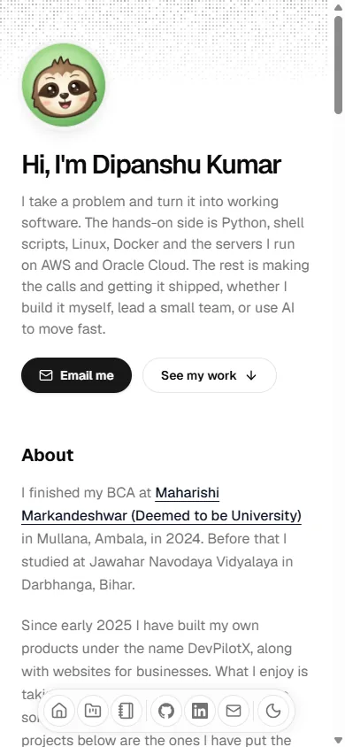
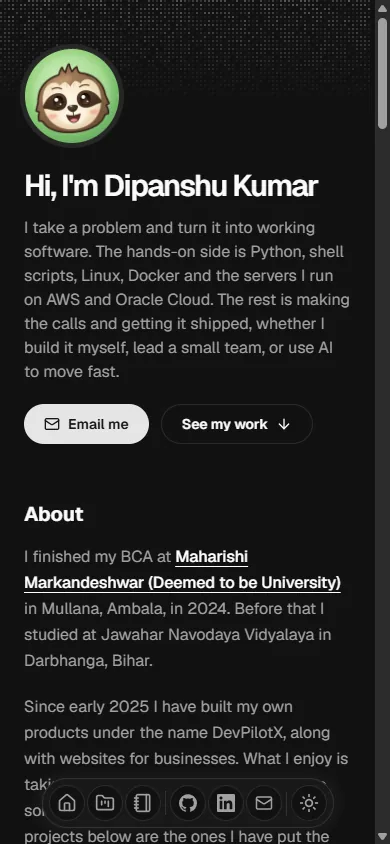
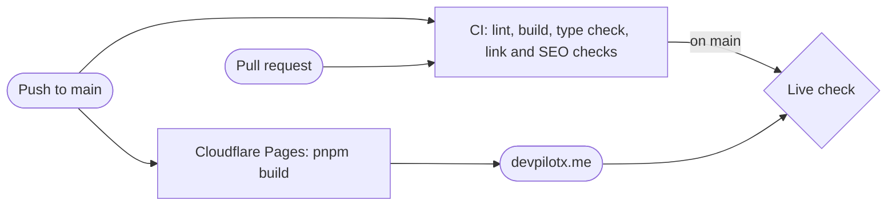

<div align="center">

<a href="https://devpilotx.me/"></a>

# Hi, I'm Dipanshu Kumar

**I take a problem and build the software that solves it.**

I work under the name DevPilotX, from India. This repository is my GitHub profile and the source of my site, [devpilotx.me](https://devpilotx.me/).

<p>
  <a href="https://devpilotx.me/"></a>
  <a href="mailto:connect@devpilotx.me"></a>
  <a href="https://buymeacoffee.com/devpilotx"></a>
</p>

<p>
  <a href="https://github.com/devpilotX/devpilotX/actions/workflows/ci.yml"></a>
  
  <a href="https://github.com/devpilotX/devpilotX/blob/main/LICENSE"></a>
</p>

<p>
  
  
  
  
  
</p>

<p>
  <a href="https://www.linkedin.com/in/dipanshu03j">LinkedIn</a> &nbsp;·&nbsp;
  <a href="https://x.com/devpilotx">X</a> &nbsp;·&nbsp;
  <a href="https://www.instagram.com/devpilotx">Instagram</a> &nbsp;·&nbsp;
  <a href="https://www.youtube.com/@devpilotx">YouTube</a>
</p>

<p>
  <a href="#about-me">About me</a> &nbsp;•&nbsp;
  <a href="#featured-projects">Projects</a> &nbsp;•&nbsp;
  <a href="#about-this-site">This site</a> &nbsp;•&nbsp;
  <a href="#quick-start">Quick start</a> &nbsp;•&nbsp;
  <a href="#writing-a-post">Writing a post</a> &nbsp;•&nbsp;
  <a href="#get-in-touch">Contact</a>
</p>

<br>

<a href="https://devpilotx.me/">
  <picture>
    <source media="(prefers-color-scheme: dark)" srcset="https://github.com/devpilotX/devpilotX/raw/main/.github/assets/home-dark.webp">
    
  </picture>
</a>

<sub>The screenshot follows your GitHub theme.</sub>

</div>

<br>

## About me

I finished my BCA at Maharishi Markandeshwar (Deemed to be University), Mullana, in 2024. Before that I studied at Jawahar Navodaya Vidyalaya in Darbhanga, Bihar.

I take a problem and turn it into working software. The hands-on side is Python, shell scripts, Linux, Docker and the servers I run on AWS and Oracle Cloud. The rest is making the calls and getting it shipped, whether I build it myself, lead a small team, or use AI to move fast.

## Featured projects

<table>
  <tr>
    <td width="50%" valign="top">
      <a href="https://devpilotx.me/projects/techcyme/"></a>
      <h3><a href="https://devpilotx.me/projects/techcyme/">Techcyme</a></h3>
      The public website and the private CRM for a digital marketing studio, as one app. Live at <a href="https://techcyme.com">techcyme.com</a>.
    </td>
    <td width="50%" valign="top">
      <a href="https://devpilotx.me/projects/paisareality/"></a>
      <h3><a href="https://devpilotx.me/projects/paisareality/">PaisaReality</a></h3>
      Free personal finance site for India: daily gold, silver and fuel prices for 50+ cities, a government scheme finder and money calculators. Live at <a href="https://paisareality.com">paisareality.com</a>.
    </td>
  </tr>
  <tr>
    <td width="50%" valign="top">
      <a href="https://devpilotx.me/projects/maanak/"></a>
      <h3><a href="https://devpilotx.me/projects/maanak/">Maanak</a></h3>
      Reads package labels with OCR, checks them against India's labelling rules and keeps a record anyone can verify later. Prototype.
    </td>
    <td width="50%" valign="top">
      <a href="https://devpilotx.me/projects/quantsys/"></a>
      <h3><a href="https://devpilotx.me/projects/quantsys/">quantsys</a></h3>
      Rules-based trading for Indian stocks and index futures that tests ideas on past data and trades on paper. Not investment advice.
    </td>
  </tr>
</table>

There are 11 more on [devpilotx.me/projects](https://devpilotx.me/projects/), from a database written in Rust to a maths proof checked in Lean 4.

## What I work with

<p>
  
</p>

Plus GitHub, Oracle Cloud and the AI tools I build with.

## About this site

devpilotx.me is a Next.js 16 site exported to plain HTML, CSS and JavaScript, so Cloudflare Pages only has files to serve. My profile and projects live in two TypeScript files, posts are MDX files, and every page gets its sharing image, structured data and sitemap entry when the site is built.

<table>
  <tr>
    <td width="50%" valign="top">
      <h3>Pages and writing</h3>
      <ul>
        <li>Home page with about, featured projects, work, education, skills, the latest posts and contact</li>
        <li>A page for each featured project: my role, who it is for, how it was built, the stack and a desktop and phone gallery</li>
        <li>Blog in MDX, with code highlighted at build time, a copy button on every code block and share links for X and LinkedIn</li>
        <li>Light and dark themes, a skip link, labelled dock buttons, and no fade-in for people who ask for reduced motion</li>
      </ul>
    </td>
    <td width="50%" valign="top">
      <h3>Search and sharing</h3>
      <ul>
        <li>Canonical URL, Open Graph and Twitter tags on every page</li>
        <li>A 1200×630 sharing image for every page and post, rendered at build time</li>
        <li>JSON-LD for my profile, the site, each project, the blog and each post, plus breadcrumbs</li>
        <li>Sitemap with image entries, robots.txt, an RSS feed and llms.txt</li>
        <li>Search Console verified by meta tag and HTML file, and Google Analytics 4 in production builds</li>
      </ul>
    </td>
  </tr>
  <tr>
    <td width="50%" valign="top">
      <h3>Checks</h3>
      <ul>
        <li><b>Links</b>: every <code>href</code>, <code>src</code> and <code>srcset</code> in the export points at a file that exists</li>
        <li><b>Search tags</b>: one title, description and <code>h1</code> per page, canonical URLs, sharing tags, valid JSON-LD, alt text, and a sitemap that matches the pages</li>
        <li><b>Live site</b>: after a push to <code>main</code>, CI waits for the new build on devpilotx.me, then requests its assets and main pages and checks the headers</li>
      </ul>
    </td>
    <td width="50%" valign="top">
      <h3>Hosting and security</h3>
      <ul>
        <li>Static files on Cloudflare Pages, with no server code and no database</li>
        <li>Security headers from <code>public/_headers</code>: a content security policy, HSTS, X-Frame-Options, Permissions-Policy and COOP</li>
        <li>Copies on <code>*.pages.dev</code> are marked <code>noindex</code>, and source maps are removed from the export</li>
        <li>Email links are kept away from Cloudflare's address rewriting, so they work without JavaScript</li>
      </ul>
    </td>
  </tr>
</table>

## Screenshots

<div align="center">

<table>
  <tr>
    <td align="center" width="50%">
      <br>
      <sub><b>Project page</b>: role, audience and the live link, then the gallery</sub>
    </td>
    <td align="center" width="50%">
      <br>
      <sub><b>Blog post</b> in dark mode, with the code highlighted at build time</sub>
    </td>
  </tr>
</table>

<table>
  <tr>
    <td align="center">
      <br>
      <sub><b>Phone</b>, light</sub>
    </td>
    <td align="center">
      <br>
      <sub><b>Phone</b>, dark</sub>
    </td>
  </tr>
</table>

</div>

## How a change goes live



- Cloudflare Pages builds every push to `main` with `pnpm build` and publishes `out/`. It does not wait for CI, so run `pnpm check` before you push.
- CI runs the same checks on pull requests and on `main`. On `main` it then waits until devpilotx.me carries the new commit's build ID, requests the page's assets, the main pages and a made-up URL that must answer 404, and checks the security headers.
- To roll back, open the Pages project in the Cloudflare dashboard, go to **Deployments** and choose **Rollback to this deployment** on the last good one. The switch is instant. Reverting the commit and pushing works too.

## Quick start

You need Node.js 20.9 or newer and pnpm 10.

```bash
pnpm install
pnpm dev
```

Open http://localhost:3000. Edit `src/data/resume.tsx` and the page updates as you save.

## Everyday commands

| Command | What it does |
| --- | --- |
| `pnpm dev` | Development server at http://localhost:3000. Google Analytics stays off |
| `pnpm build` | Static export into `out/`. Two scripts then copy the router's segment files to the flat names the browser asks for, and delete source maps |
| `pnpm preview` | Serves `out/` with Cloudflare's Pages emulator at http://localhost:8788, with `_headers` and `_redirects` applied. The first run downloads Wrangler |
| `pnpm lint` | ESLint |
| `pnpm typecheck` | TypeScript. It needs the post types that `pnpm build` or `pnpm dev` generates |
| `pnpm check:links` | Every `href`, `src` and `srcset` in `out/` points at a file that exists |
| `pnpm check:seo` | Titles, descriptions, canonical URLs, sharing tags, JSON-LD and the sitemap of every page |
| `pnpm check` | All of it in order: lint, build, type check, links, SEO |

## Writing a post

Posts are MDX files in [`content/`](content). The file name becomes the address, so `content/my-first-post.mdx` is published at `devpilotx.me/blog/my-first-post/`.

````md
---
title: "Your post title"
publishedAt: "2026-11-02"
summary: "One or two sentences. They appear on the blog page, in search results and on the sharing card."
---

Write in Markdown. Tables, task lists and code blocks work, and a code block can have a title:

```bash title="setup.sh"
sudo apt install nginx
```
````

| Field | Required | What it does |
| --- | --- | --- |
| `title` | Yes | The heading, the page title and the title on the sharing card |
| `publishedAt` | Yes | The date, as `YYYY-MM-DD`. Posts are listed newest first |
| `summary` | Yes | Shown on the blog page and the sharing card, and used as the meta description |
| `updatedAt` | No | Adds "Updated" under the date and moves the post's date in the sitemap |
| `image` | No | A root-relative path to your own 1200×630 image in `public/`. Without it, one is rendered at build time |

Run `pnpm dev` and open http://localhost:3000/blog/ to read it, then push to `main`. Once Cloudflare has built it, the post is on the blog page, among the three latest posts on the home page, in the RSS feed, the sitemap and `llms.txt`, and it has its own sharing image. Every post ends with links to share it on X and LinkedIn and a button that copies its address.

There is no draft flag, so keep unfinished posts out of `content/`.

## Project layout

```text
src/app          pages, sharing images, sitemap, robots.txt, RSS, llms.txt and the web manifest
src/components   site components; section/ holds the home page sections
src/data         resume.tsx (profile, links, work, education, skills) and projects.ts
src/lib          SEO helpers, the sharing card renderer and blog helpers
src/assets       project screenshots, sharing card covers and the fonts the cards use
content          blog posts in MDX
public           the mascot, icons, _headers, _redirects and the Search Console file
scripts          build clean-up, and the link, SEO and live-site checks
.github          the CI workflow, the funding link and the screenshots in this README
```

## Good to know

- Search Console reads `public/google3419091e9a1248e3.html` and the `google-site-verification` tag in `src/app/layout.tsx`, so keep both. Cloudflare Pages redirects addresses that end in `.html`, and Search Console does not follow redirects for this file, so `public/_redirects` serves it in place.
- Google Analytics 4 loads only in production builds, so local work does not show up in the reports.
- Screenshots of the Techcyme CRM, Maanak and quantsys use sample or demo data.
- The design started from the open source [portfolio template by Dillion Verma](https://github.com/magicuidesign/portfolio). Both are released under the [MIT license](LICENSE).

## Get in touch

Email me at [connect@devpilotx.me](mailto:connect@devpilotx.me), or message me on [LinkedIn](https://www.linkedin.com/in/dipanshu03j) or [X](https://x.com/devpilotx). If something I built or wrote helped you, you can [buy me a coffee](https://buymeacoffee.com/devpilotx).

<br>

<div align="center">

<a href="https://devpilotx.me/"></a>

**[devpilotx.me](https://devpilotx.me/)**

<sub>© 2026 Dipanshu Kumar &nbsp;·&nbsp; MIT license</sub>

</div>
